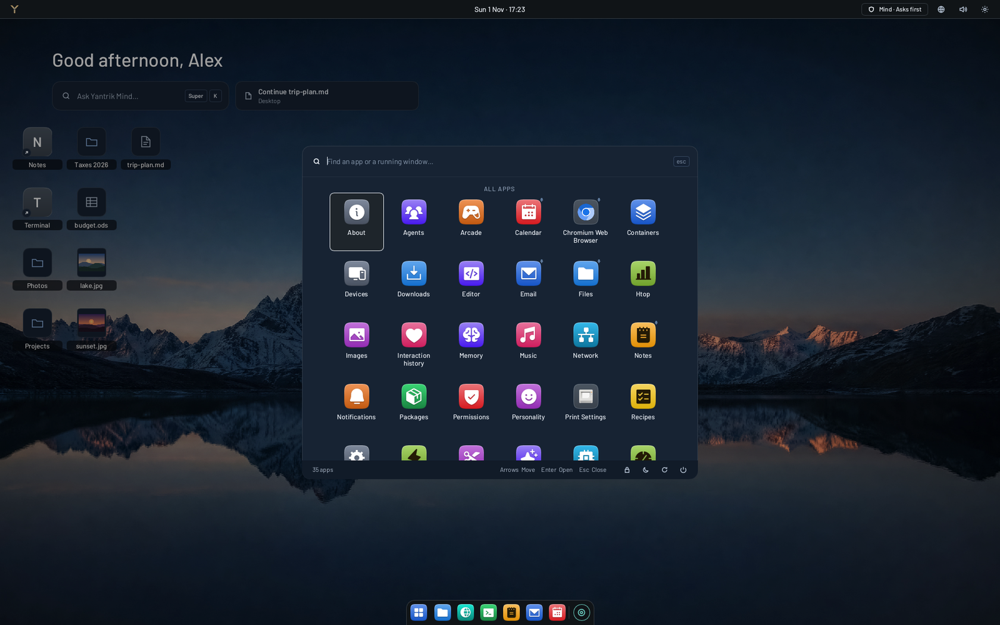
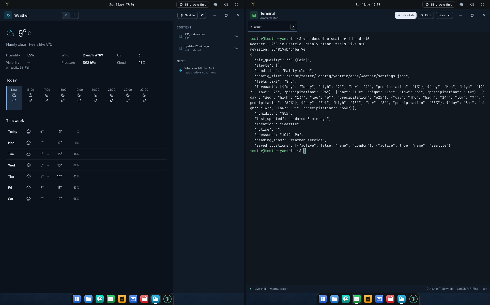
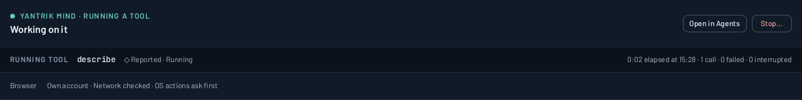
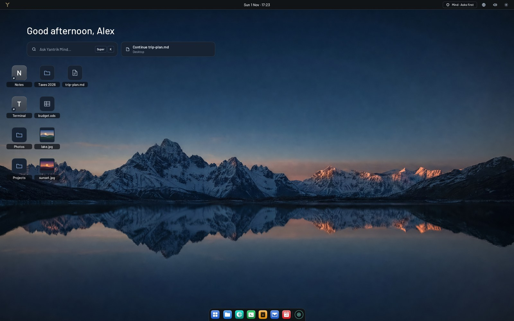
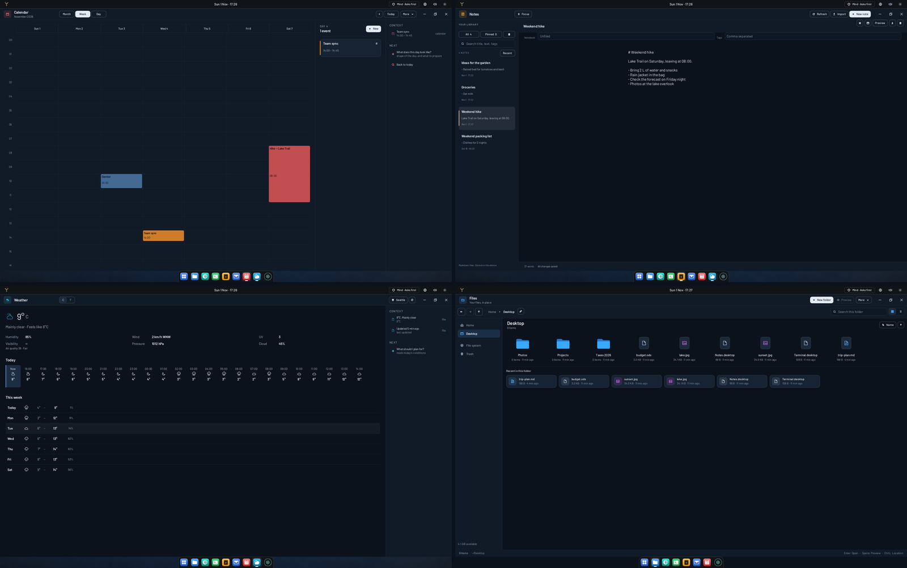

<p align="center">
  <a href="https://yantrikos.com">
    
  </a>
</p>

<h1 align="center">Yantrik — an AI-native Linux desktop</h1>

<p align="center">
  <strong>Your agents drive real apps through one control surface. Your view never moves.</strong><br>
  <sub>Early software · nightly builds · a live demo running on a real machine</sub>
</p>

<p align="center">
  <a href="https://iso.yantrikos.com/nightly/"><b>Download the nightly ISO</b></a> ·
  <a href="https://yantrikos.com/live"><b>Watch a Mind work, live</b></a> ·
  <a href="https://github.com/yantrikos/yantrik-os">Source</a> ·
  <a href="#yantrikdb">YantrikDB</a>
</p>

<p align="center">
  <a href="https://yantrikos.com"></a>
</p>

### Apps that explain themselves

Every Yantrik app describes what it's showing and the actions it takes, in plain data, through one control surface (`yos describe`, `yos act`). Claude Code, Hermes, OpenClaw, Pi and Yantrik's own Mind work from what is actually on the machine, not from screenshots and guessed clicks.

<p align="center">
  
  <br><sub>The Weather app, and what an agent reads from it: the same facts, as data it can act on.</sub>
</p>

### Minds work in their own view

A Mind opens apps in **Mind View**, its own space beside yours. A desk bar says what each Mind is doing right now, with <kbd>Stop…</kbd> and <kbd>Open in Agents</kbd> one press away. A Mind can't move your screen, raise a window over your work, or close yours. Anything destructive asks first, and so does every email it would send, with the whole text on the card.

<p align="center">
  
  <br><sub>The desk bar over Mind View, captured on a test machine.</sub>
</p>

### A desktop that is a desktop

Files, folders and app shortcuts sit where you put them, with real thumbnails and a Continue row for what you had open. Archive moves things out of the way and Undo brings them back. Nothing is ever deleted on your behalf.

<p align="center">
  
</p>

### 18 apps on one framework

Calendar, Notes, Weather, Files, Email, Terminal, Editor, Music, Images and more, all built on the same app framework, so every one of them speaks the control surface from the start.

<p align="center">
  
</p>

<table>
<tr>
<td width="33%" valign="top"><b>Private by default</b><br><sub>Your keys live in a vault. A Mind that needs your city reads your own Weather app instead of sending it out.</sub></td>
<td width="33%" valign="top"><b>Signed updates</b><br><sub>Releases are signed with ed25519 and checked before anything installs. Old releases can't be replayed.</sub></td>
<td width="33%" valign="top"><b>Honest about state</b><br><sub>Nightly builds publish as they pass their tests on a real machine, and the live demo shows exactly what a Mind does.</sub></td>
</tr>
</table>

---

<p></p>

<h2 id="yantrikdb">YantrikDB — the memory under it all</h2>

**Your agent forgets your project between sessions. This is the database that remembers.** Local-first and inspectable, it consolidates duplicates, catches contradictions, and answers "what did you believe in March?". It works with Claude Code, Cursor, Codex, Windsurf and anything that speaks MCP, and it's the memory every agent on Yantrik OS shares.

<p>
  <a href="https://pypi.org/project/yantrikdb/"></a>
  <a href="https://pypi.org/project/yantrikdb/"></a>
  <a href="https://crates.io/crates/yantrikdb"></a>
  <a href="https://github.com/yantrikos/yantrikdb/blob/main/LICENSE"></a>
</p>

```json
{ "mcpServers": { "yantrikdb": { "command": "uvx", "args": ["yantrikdb-mcp"] } } }
```

<sub>No account, no API key, no cloud: memory lives in one SQLite file on your machine. Codex: <code>codex mcp add yantrikdb -- uvx yantrikdb-mcp</code> · Python or Rust: <code>pip install yantrikdb</code> / <code>cargo add yantrikdb</code></sub>

| | A notes file | A vector store | YantrikDB |
|---|---|---|---|
| Recalls only what is relevant | ✗ | ✓ | ✓ |
| Notices a fact changed | ✗ | ✗ | ✓ keeps the history |
| Surfaces contradictions | ✗ | ✗ | ✓ |
| Says *why* it recalled something | ✗ | ✗ | ✓ |
| Point-in-time recall | ✗ | ✗ | ✓ |

**Evidence, including what didn't work:**
- [LongMemEval retrieval](https://yantrikdb.com/papers/longmemeval-retrieval/): every gold session retrieved for 98.7% of queries at k=40, with the command to rerun it.
- [The benchmark ledger](https://yantrikdb.com/research/benchmarks/).
- [Memory Lab](https://yantrikdb.com/#memory-lab), in your browser.
- The failed experiments stay published too.

[Quick start](https://yantrikdb.com/guides/quickstart/) · [MCP setup](https://yantrikdb.com/guides/mcp/) · [Memory Atlas](https://yantrikdb.com/guides/memory-atlas/) · [Discussions](https://github.com/yantrikos/yantrikdb-server/discussions)

---

## The projects

| Project | What it is |
|---|---|
| [`yantrik-os`](https://github.com/yantrikos/yantrik-os) | The desktop: shell, native apps, the control surface agents use, Mind View, signed updates |
| [`yantrik-mind`](https://github.com/yantrikos/yantrik-mind) | Yantrik's own Mind: a Rust agent on YantrikDB's typed memory, behind one harm gate |
| [`yantrikdb-server`](https://github.com/yantrikos/yantrikdb-server) | Self-hosted memory server: HTTP and wire APIs, tenancy, replication |
| [`yantrikdb`](https://github.com/yantrikos/yantrikdb) | The memory engine: a Rust core with Python bindings (Apache-2.0) |
| [`yantrikdb-mcp`](https://github.com/yantrikos/yantrikdb-mcp) | An MCP server for Claude Code, Cursor, Codex, Windsurf and others |
| [`yantrikdb-hermes-plugin`](https://github.com/yantrikos/yantrikdb-hermes-plugin) | A memory provider for Hermes Agent |
| [`tier`](https://github.com/yantrikos/tier) | Research: how small models pick the right tool out of many |

<details>
<summary><b>Try Yantrik OS</b></summary>

1. Download the nightly ISO from [iso.yantrikos.com/nightly](https://iso.yantrikos.com/nightly/). Boot it live, or install it next to what you have.
2. First run asks for one AI provider (local or cloud) and sets up the memory.
3. Press <kbd>Super</kbd> + <kbd>K</kbd> to ask a Mind, or open **Agents** to give it work and watch it in Mind View.

Updates arrive signed on the nightly channel. It's early: [open an issue](https://github.com/yantrikos/yantrik-os/issues) when something's wrong; that's the most useful thing you can do.
</details>

<p align="center"><sub>Built in the open · Apache-2.0 where noted in each repo · <a href="https://yantrikos.com">yantrikos.com</a> · <a href="https://yantrikdb.com">yantrikdb.com</a></sub></p>
